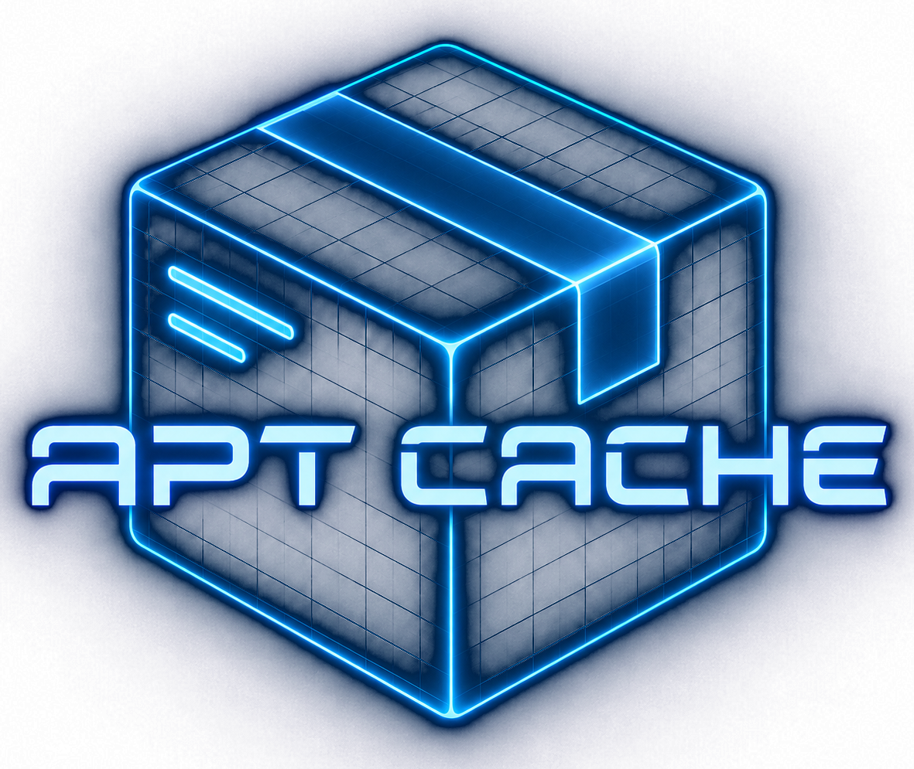

<p align="center">
  
</p>

<h1 align="center">Cache APT Packages</h1>

<p align="center">
  Cache APT packages between GitHub Actions runs, so a run restores them instead of installing them again.
</p>

<p align="center">
  <a href="https://github.com/awalsh128/cache-apt-pkgs-action/releases/latest"></a>
  <a href="https://github.com/awalsh128/cache-apt-pkgs-action/actions/workflows/ci.yml?query=branch%3Amain-2"></a>
  <a href="https://codecov.io/gh/awalsh128/cache-apt-pkgs-action/tree/main-2"></a>
  <a href="https://github.com/awalsh128/cache-apt-pkgs-action/actions/workflows/ci.yml?query=branch%3Astaging-2"></a>
  <a href="https://codecov.io/gh/awalsh128/cache-apt-pkgs-action/tree/staging-2"></a>
</p>

Cache APT packages between workflow runs, so a run restores them from the GitHub Actions cache instead of
installing them again. It is built on
[`@actions/cache`](https://github.com/actions/toolkit/tree/main/packages/cache) and
[ts-apt](https://github.com/awalsh128/ts-apt).

- ⚡ Skips the install on a cache hit and restores the packages from an archive.
- 📦 Caches the dependencies too, so the whole installed set comes back (e.g. `graphviz` and the libraries it
  pulls in).
- 🔑 Keeps one cache for each package list, `version` label and architecture.
- 🧾 Reports the exact installed versions as outputs, for audit logs.
- 🔍 Uploads the logs and manifests as an artifact when `debug` is on.

<!-- prettier-ignore -->
<p align="center">
  <a href="https://github.com/sponsors/awalsh128"></a>
</p>

<p align="center">
  Free and open source, and kept up by one person.<br />
  If it saves you time, <a href="https://github.com/sponsors/awalsh128">sponsor it monthly</a> or
  <a href="https://github.com/sponsors/awalsh128?frequency=one-time">leave a small one-time tip</a>. Every bit
  helps.
</p>

<!-- prettier-ignore -->
> [!IMPORTANT]
> v2 is stable. Use `@v2` (or an exact release like `v2.0.0`) for new and existing workflows. v1 is in
> maintenance mode and only gets bug and reliability fixes, so use `@v1` only if you need what v2 dropped
> (e.g. `add-repository`). The [Version 2 FAQ](V2_FAQ.MD) covers what changes.

<!-- prettier-ignore -->
> [!NOTE]
> I'm looking for co-maintainers to help review changes and investigate issues. I haven't had as much
> time for this action as I would like, and I want it to stay responsive for the community. Reach out if you
> are interested.

## Quick Start

```yaml
steps:
  - uses: awalsh128/cache-apt-pkgs-action@v2.0.0
    with:
      packages: graphviz doxygen
      version: 1.0
```

Change `version` to start a fresh cache (e.g. after a runner image change).

## Requirements

A Linux runner with APT (e.g. GitHub-hosted `ubuntu-latest`). The action runs on `node24`, so self-hosted
runners need a runner version that supports it. GitHub-hosted runners already do.

## Configuration

### Inputs

| Name                      | Description                                                                                                                             | Required | Default |
| ------------------------- | --------------------------------------------------------------------------------------------------------------------------------------- | -------- | ------- |
| `packages`                | Space delimited list of packages to install. Pin a version with APT syntax (e.g. `xdot=1.2-2`).                                         | Yes      |         |
| `version`                 | Cache version label. Each label has its own cache, so change it to start a fresh one. It can't contain spaces.                          | No       | `""`    |
| `execute_install_scripts` | Run each package's `preinst` and `postinst` script after a restore. See [Non-file dependencies](docs/caveats.md#non-file-dependencies). | No       | `false` |
| `empty_packages_behavior` | What to do when `packages` is empty: `error` fails the action, `warn` logs a warning and skips, `ignore` skips quietly.                 | No       | `error` |
| `debug`                   | Log more detail and upload the logs and manifests as a workflow artifact (a failed run uploads them anyway). Costs a little time.       | No       | `false` |

### Outputs

| Name                       | Description                                                                                                                                                                           |
| -------------------------- | ------------------------------------------------------------------------------------------------------------------------------------------------------------------------------------- |
| `cache-hit`                | `true` when a cache was found for the packages requested.                                                                                                                             |
| `package-version-list`     | The requested packages and the versions installed, as a sorted comma list (e.g. `curl=8.5.0,jq=1.7.1`). A package for a non-native architecture includes it (e.g. `libc6:i386=2.39`). |
| `all-package-version-list` | The same format for every package installed, dependencies included.                                                                                                                   |

## Versions

- `@v2` is the latest stable v2 release. It moves on each stable release, and it is the only tag that ever
  moves.
- `@v#.#.#` is an exact release (e.g. `v2.0.0`). It never changes once published. Release candidates, cut from
  `staging-2` after CI passes, are tagged `v#.#.#-rc.#` and may be unstable. `@v2` never points at one.
- `@v1` is the last v1 release line, in maintenance mode on the frozen `master` branch.
- A full commit SHA pins the exact code and is the safest choice.

A tag that moves lets a compromised release change what your workflow runs. If that matters to you, pin an
exact release or a commit SHA instead of `@v2`. `@latest` and `@v1` are moving tags too, and they only point
at v1.

Version 1 is maintained on the frozen `master` branch. Version 2 is released from tags only. The `main-2` and
`staging-2` branches hold source without the built `dist/`, so do not use them as `uses:` refs.

## Cache scopes

The cache is scoped to the packages given and the ref that saved it. A run can restore caches from its own
branch or tag and from the default branch. Tags do not share caches with each other, so a workflow that only
runs on tag pushes (e.g. releases) misses every time. To share a cache across tags, run the action with the
same `packages` and `version` on the default branch (e.g. on push or on a `schedule`).

GitHub evicts the oldest caches when a repository goes over its storage limit (10 GB by default), and any
cache that goes a week without being used. A large package set (e.g. `texlive-full`) can be evicted before the
next run. See
[Managing caches](https://docs.github.com/en/actions/using-workflows/caching-dependencies-to-speed-up-workflows#viewing-cache-entries)
to inspect yours.

## Example workflow

This was the motivating use case for the action.

```yaml
name: Create Documentation
on: push
jobs:
  build_and_deploy_docs:
    runs-on: ubuntu-latest
    steps:
      - uses: actions/checkout@v4
      - uses: awalsh128/cache-apt-pkgs-action@v2.0.0
        with:
          packages: dia doxygen doxygen-doc doxygen-gui doxygen-latex graphviz mscgen
          version: 1.0

      - name: Build
        run: |
          cmake -B ${{github.workspace}}/build -DCMAKE_BUILD_TYPE=${{env.BUILD_TYPE}}
          cmake --build ${{github.workspace}}/build --config ${{env.BUILD_TYPE}}

      - name: Deploy
        uses: JamesIves/github-pages-deploy-action@4.1.5
        with:
          branch: gh-pages
          folder: ${{github.workspace}}/build/website
```

For stricter setups (e.g. pinned package versions or minimal permissions), see [Hardening](docs/hardening.md).

## ⚠️ Caveats

A restore only extracts files, so some packages need more than that. See [Caveats](docs/caveats.md) for the
details and the fixes.

- [Non-file dependencies](docs/caveats.md#non-file-dependencies): the Debian package database and triggers
  aren't updated. Set `execute_install_scripts` or install that package in its own step.
- [Runner image changes](docs/caveats.md#runner-image-changes): the cache key doesn't include the runner
  image. Put `ImageOS` and `ImageVersion` into `version`.
- [Stalled mirrors](docs/caveats.md#stalled-mirrors): a cache miss can stall on the default Ubuntu mirror.
  Point `apt` at `archive.ubuntu.com`.

See [CONTRIBUTING.md](CONTRIBUTING.md) if you want to help.
