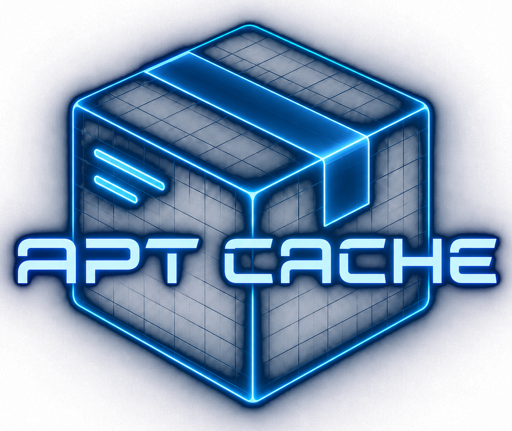

<p align="center"></p>
<h1 align="center">Cache APT Packages Action</h1>

[](https://github.com/awalsh128/cache-apt-pkgs-action/blob/master/LICENSE)
[](https://github.com/awalsh128/cache-apt-pkgs-action/actions/workflows/action-tests.yml?query=branch%3Amaster)
[](https://github.com/awalsh128/cache-apt-pkgs-action/actions/workflows/action-tests.yml?query=branch%3Adev)
[](https://github.com/awalsh128/cache-apt-pkgs-action/releases)

This action allows caching of Advanced Package Tool (APT) package dependencies to improve workflow execution time instead of installing the packages on every run.

> [!IMPORTANT]
> Version 1 is in maintenance mode. Recent releases have been unstable, so v1 is locked to bug fixes and reliability work. Version 2 is in development on the [`main-2`](https://github.com/awalsh128/cache-apt-pkgs-action/tree/main-2) branch. It is written in TypeScript, has better test coverage and relies much less on Bash scripts, which have caused more than one major break.

> [!TIP]
> If you find this project useful, please consider supporting it [as a sponsor and show some ❤️ for open source maintainers](https://github.com/sponsors/awalsh128).

> [!NOTE]
> Looking for co-maintainers to help review changes and investigate issues. I haven't had as much time to stay on top of this action as I would like, and I want to make sure it stays responsive and reliable for the community. If you are interested, please reach out.

## Documentation

This action is a composition of [actions/cache](https://github.com/actions/cache/) and the `apt` utility. Some actions require additional APT based packages to be installed in order for other steps to be executed. Packages can be installed when ran but can consume much of the execution workflow time.

## Usage

### Pre-requisites

Create a workflow `.yml` file in your repositories `.github/workflows` directory. An [example workflow](#example-workflow) is available below. For more information, reference the GitHub Help Documentation for [Creating a workflow file](https://help.github.com/en/articles/configuring-a-workflow#creating-a-workflow-file).

### Versions

There are two kinds of version labels you can use.

- `@v#` - Major only will give you the latest release for that major version only (e.g. `v1`).
- Branch
  - `@master` - Most recent manual and automated tested code. Possibly unstable since it is pre-release (publishes as `1.x.x`).
  - `@dev` - Very unstable and contains experimental features.
  - `@main-2` - Version 2 in development. Not released yet; do not use in production workflows.

The `latest` tag is deprecated and will no longer be updated. Pin to a major version (e.g. `@v1`), a release tag (e.g. `@v1.6.3`) or a full commit SHA instead.

### Inputs

- `packages` - Space delimited list of packages to install. A version can optionally be given using APT syntax `<name>=<version>` (e.g. `xdot=1.2-2`).
- `version` - Version of cache to load. Each version will have its own cache. Note, all characters except spaces are allowed.
- `execute_install_scripts` - Execute Debian package pre and post install script upon restore. See [Caveats / Non-file Dependencies](#non-file-dependencies) for more information.
- `empty_packages_behavior` - Desired behavior when the given `packages` is empty. `'error'` (default), `'warn'` or `'ignore'`.
- `add-repository` - Space delimited list of repositories to add via `apt-add-repository` before installing packages. Supports PPA (e.g., `ppa:user/repo`) and other repository formats.
- `debug` - Enable debug logging and upload the action logs as a workflow artifact. Minor performance penalty. Default `false`.
- `refresh` - **Obsolete.** Not used by the action; use `version` instead.

### Outputs

- `cache-hit` - A boolean value to indicate a cache was found for the packages requested.
- `package-version-list` - The main requested packages and versions that are installed. Represented as a comma delimited list with equals delimit on the package version (i.e. \<package1>=<version1\>,\<package2>=\<version2>,...).
- `all-package-version-list` - All the pulled in packages and versions, including dependencies, that are installed. Represented as a comma delimited list with equals delimit on the package version (i.e. \<package1>=<version1\>,\<package2>=\<version2>,...).

### Errors

The action checks its inputs before doing anything else, and fails the step with its own exit code for each problem so you can tell them apart in the logs.

| Code | Cause                                                                      |
| ---- | -------------------------------------------------------------------------- |
| 1    | `debug` is not `true` or `false`.                                          |
| 2    | `version` contains spaces.                                                 |
| 3    | `packages` is empty and `empty_packages_behavior` is `error`.              |
| 4    | `execute_install_scripts` is not `true` or `false`.                        |
| 6    | A value in `add-repository` contains invalid characters.                   |

> [!NOTE]
> v1 doesn't catch every package resolution or install failure, so the action can report success after an incomplete install. Failing on these errors is planned for v2 (see [#230](https://github.com/awalsh128/cache-apt-pkgs-action/issues/230)).

### Security Compliance

This is a composite action. It runs Bash scripts and a small Go helper (`apt_query`), committed as prebuilt binaries for x86 and arm64, on the runner. It uses `sudo` to install packages. Consumers don't need to install anything else.

For workflows with stricter compliance requirements, the main security characteristics are:

- `packages` should be treated as an allowlisted input in your workflow. Prefer explicit package names and versions where reproducibility matters.
- `version` can be used as a cache namespace so you can intentionally rotate caches when package policy or runner baselines change.
- `empty_packages_behavior` can be left at the default `error` to fail closed when an expected package list is missing.
- `execute_install_scripts` is disabled by default. Enable it only when required, because Debian maintainer scripts run arbitrary package-provided shell logic during restore.
- `debug` is disabled by default. When enabled, logs are uploaded as a workflow artifact. Review them before sharing outside your organization.
- `add-repository` adds third-party APT sources to the runner. Only add repositories you trust.
- On a cache miss, if `apt-fast` isn't already on the runner, the action downloads and runs its install script from the [apt-fast](https://github.com/ilikenwf/apt-fast) repository.

#### Features

Security-relevant action features:

- Package inputs are normalized and sorted before cache lookup, which reduces accidental cache divergence from ordering or duplicate whitespace in the package list.
- Unpinned package names are resolved to concrete package versions before the cache key is generated, which improves traceability of what was actually cached for a run.
- Cache keys are derived from the normalized package set, the user-provided `version`, the added repositories and the runner architecture, which helps isolate caches across package changes and incompatible platforms.
- The action rejects invalid boolean inputs, `version` values containing spaces and repository values with invalid characters.
- Actions that this action depends on (`actions/cache`, `actions/upload-artifact`) are pinned to full commit SHAs.
- The `package-version-list` and `all-package-version-list` outputs can be captured by downstream workflow steps for audit logs, attestation inputs, or compliance reporting.

#### Usage Recommendations

For GitHub Actions workflow hardening, prefer the following controls around this action:

- Pin this action to a release tag you trust, or to a full commit SHA for stricter supply chain control.
- Use the minimum required workflow `permissions` instead of broad defaults.
- Run on GitHub-hosted or otherwise trusted runners with controlled APT sources.
- Limit who can modify workflow files and package lists through branch protection and pull request review.
- Review whether cached APT contents are acceptable for your repository's cache retention policy and data handling requirements.

Example hardened usage:

```yaml
permissions:
  contents: read

jobs:
  build:
    runs-on: ubuntu-24.04
    steps:
      - uses: actions/checkout@9c091bb21b7c1c1d1991bb908d89e4e9dddfe3e0 # v7.0.0
      - uses: awalsh128/cache-apt-pkgs-action@v1.6.3
        with:
          packages: curl=8.5.0-2ubuntu10.6 jq=1.7.1-3build1
          version: ubuntu-24.04-v1
          empty_packages_behavior: error
          execute_install_scripts: false
```

### Cache scopes

The cache key is built from the `packages`, `version` and `add-repository` inputs, plus the runner's CPU architecture. The branch name is not part of the key.

GitHub still limits which caches a workflow run can restore (see [Restrictions for accessing a cache](https://docs.github.com/en/actions/using-workflows/caching-dependencies-to-speed-up-workflows#restrictions-for-accessing-a-cache)). A run can restore caches created on its own branch, or on the base branch (e.g. the default branch, or the base branch of a pull request). It can't restore caches created on sibling branches, even when the key is the same.

If you see a separate cache for every branch or pull request, it is likely because the default branch has never saved one. Run the workflow on the default branch (e.g. on `push` to `master`) so the cache is created there. After that, every branch and pull request with the same inputs will restore it instead of installing the packages again.

### Example workflow

This was a motivating use case for creating this action.

```yaml
name: Create Documentation
on: push
jobs:
  build_and_deploy_docs:
    runs-on: ubuntu-latest
    name: Build Doxygen documentation and deploy
    steps:
      - uses: actions/checkout@9c091bb21b7c1c1d1991bb908d89e4e9dddfe3e0 # v7.0.0
      - uses: awalsh128/cache-apt-pkgs-action@v1
        with:
          packages: dia doxygen doxygen-doc doxygen-gui doxygen-latex graphviz mscgen
          version: 1.0

      - name: Build
        run: |
          cmake -B ${{github.workspace}}/build -DCMAKE_BUILD_TYPE=${{env.BUILD_TYPE}}
          cmake --build ${{github.workspace}}/build --config ${{env.BUILD_TYPE}}

      - name: Deploy
        uses: JamesIves/github-pages-deploy-action@4.1.5
        with:
          branch: gh-pages
          folder: ${{github.workspace}}/build/website
```

```yaml
---
install_doxygen_deps:
  runs-on: ubuntu-latest
  steps:
    - uses: actions/checkout@9c091bb21b7c1c1d1991bb908d89e4e9dddfe3e0 # v7.0.0
    - uses: awalsh128/cache-apt-pkgs-action@v1
      with:
        packages: dia doxygen doxygen-doc doxygen-gui doxygen-latex graphviz mscgen
        version: 1.0
```

### Using with Third-party PPAs

This example shows how to install packages from a third-party PPA:

```yaml
install_from_ppa:
  runs-on: ubuntu-latest
  steps:
    - uses: actions/checkout@9c091bb21b7c1c1d1991bb908d89e4e9dddfe3e0 # v7.0.0
    - uses: awalsh128/cache-apt-pkgs-action@v1
      with:
        packages: chromium-browser
        add-repository: ppa:canonical-chromium-builds/stage
        version: 1.0
```

You can also add multiple repositories:

```yaml
install_from_multiple_repos:
  runs-on: ubuntu-latest
  steps:
    - uses: actions/checkout@9c091bb21b7c1c1d1991bb908d89e4e9dddfe3e0 # v7.0.0
    - uses: awalsh128/cache-apt-pkgs-action@v1
      with:
        packages: package1 package2
        add-repository: ppa:user/repo1 ppa:user/repo2
        version: 1.0
```

## Caveats

### Non-file Dependencies

This action is based on the principle that most packages can be cached as a fileset. There are situations though where this is not enough.

- Pre and post installation scripts needs to be ran from `/var/lib/dpkg/info/{package name}.[preinst, postinst]`.
- The Debian package database needs to be queried for scripts above (i.e. `dpkg-query`).

The `execute_install_scripts` argument can be used to attempt to execute the install scripts but they are not guaranteed to resolve the issue.

```yaml
- uses: awalsh128/cache-apt-pkgs-action@v1
  with:
    packages: mypackage
    version: 1.0
    execute_install_scripts: true
```

If this does not solve your issue, you will need to run `apt-get install` as a separate step for that particular package unfortunately.

```yaml
run: apt-get install mypackage
shell: bash
```

Please reach out if you have found a workaround for your scenario and it can be generalized. There is only so much this action can do and can't get into the area of reverse engineering Debian package manager. It would be beyond the scope of this action and may result in a lot of extended support and brittleness. Also, it would be better to contribute to Debian packager instead at that point.

For more context and information see [issue #57](https://github.com/awalsh128/cache-apt-pkgs-action/issues/57#issuecomment-1321024283) which contains the investigation and conclusion.

### Virtual Packages

Virtual packages are resolved to a concrete package that provides them. A virtual package with no provider (e.g. `python` on Ubuntu 22.04) can't be resolved. Use the concrete package name instead (e.g. `python3`).

### Cache Limits

A repository can have up to 10GB of caches. Once the limit is reached, older caches will be evicted based on when the cache was last accessed. Caches that are not accessed within the last week will also be evicted. To get more information on how to access and manage your actions's caches, see [GitHub Actions / Using workflows / Cache dependencies](https://docs.github.com/en/actions/using-workflows/caching-dependencies-to-speed-up-workflows#viewing-cache-entries).
