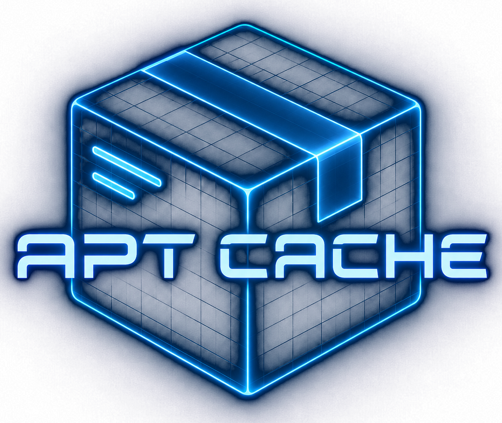

  

<h1 align="center">Cache APT Packages v2 FAQ</h1>

## Why did you create a new version?

### Bash Scripts

Bash shell scripting grew in complexity and became very unreadable. The action needed higher level language
idioms like:

- arrays, map handling, complex pattern matching, and complex text processing;
- robust logging, debugging, other instrumentations; and
- avoiding cryptic shell and system environment considerations.

v2 moves that logic into typed, tested TypeScript.

### Language Choice

Languages like Python, Go, Rust, etc. have performance and writeability trade offs that would also meet these
requirements, but ultimately Typescript was chosen because it:

- is the most performant and well supported for GitHub actions;
- has native strongly typed libraries for actions maintained by GitHub like
  - [`@actions/core`](https://github.com/actions/toolkit/tree/main/packages/core) for runtime environment, and
  - other common services like [`@actions/cache`](https://github.com/actions/toolkit/tree/main/packages/cache)
    and [`@actions/artifact`](https://github.com/actions/toolkit/tree/main/packages/artifact);
- requires no binary compilation;
- provides a balance of code comprehension and performance for contributors; and
- allows for better continuous integration, release workflow, hermetic unit testing, and smoke testing.

## Where did all the APT functionality go?

Since this has been a complex part of the codebase, I decided to separate the concern as its own library. This
can now be found at [`npm/ts-apt`](https://www.npmjs.com/package/ts-apt) with the sourcecode in the
[`awalsh128/ts-apt`](http://github.com/awalsh128/ts-apt) repository.

For ease of use there is an option to bring in the workspace for inline source via
`npm run dev:tsapt:[un]link` so it can be debugged and then PR'd to the
[awalsh128/ts-apt](http://github.com/awalsh128/ts-apt) repository.

## How do I start using this?

v2 is stable and released from tags only. See the [README](README.md#versions) for the tags.

**The inputs and outputs are backwards compatible, with one exception:** `add-repository` (adding PPAs and
other repositories before install) and the already obsolete `refresh` input are gone. Add a repository in a
step before the action instead. The action runs on the `node24` runtime, so self-hosted runners need a runner
version that supports it (GitHub-hosted runners already do).

- Change to `@v2` (latest stable v2), an exact `v2.*.*` release or a commit SHA in your GitHub workflow. `v2`
  is the only tag that moves.
- `v1.*` will still get patch updates but is in maintenance mode. Stay on `@v1` if you need `add-repository`.

## Some internal changes

- Logging uses native GitHub calls that will result in run annotations.
- Output is more verbose than v1.
- When `debug` is on (or a run fails), the manifests, the cache key and the logs are uploaded as a workflow
  artifact.
- Debug mode can either be specified via an input parameter `debug` or
  [as part of the repository settings](https://docs.github.com/en/actions/how-tos/monitor-workflows/enable-debug-logging).
